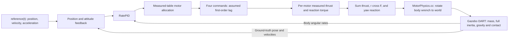

# Force-driven flight simulation

The default `python3 control/example.py --gazebo` now runs a dynamic Gazebo
Fortress rigid body. It never commands the vehicle pose or velocity.



## Running

From the repository root:

```bash
python3 control/example.py --gazebo
python3 control/example.py --gazebo --headless --duration 38
python3 control/final_control.py --headless --duration 10
```

The source runner automatically configures/builds `simulation/` with CMake.
Required packages include Gazebo Fortress development files, its DART backend,
Python development headers, a C++17 compiler, CMake, NumPy and SciPy. On Ubuntu
22.04 the development packages include `libignition-gazebo6-dev`,
`libignition-physics5-dev`, `libignition-plugin1-dev`, and `python3-dev`.

The GUI uses `ign gazebo` and the custom system plugin. Headless mode runs the
same DART engine, generated SDF, C++ adapter and Python controller directly,
without a rendering server or transport sockets. It defaults to 30 simulated
seconds if duration is omitted. GUI mode runs until stopped when duration is 0.
Each run saves `physics.sdf`, effective `config.json` and `telemetry.csv` under
`simulation/runs/`. Simulation timestamps, not wall-clock time, drive control.

ROS launch also uses physics after rebuilding:

```bash
source /opt/ros/humble/setup.bash
cd ros2_ws
colcon build --symlink-install
source install/setup.bash
ros2 launch emsd_drone_description gazebo.launch.py
ros2 launch emsd_drone_description gazebo.launch.py headless:=true duration:=38
```

The runner installs with the description package. It finds installed binaries
without rebuilding and writes run artifacts relative to the working directory.
RViz remains a geometry viewer. `worlds/frame.sdf` is the scene template: the
runner generates a dynamic single-body drone from it and combines the fixed
motor visuals into the base link before launching.

## Mass and inertia

User-supplied approximate masses:

| Component | Mass |
|---|---:|
| Central frame plus electronics | 244 g |
| Four arms | 4 × 42 g |
| Four motors | 4 × 72 g |
| Total modeled mass | 700 g |

`tools/derive_mass_properties.py` finds the four matching arm solids in the
19-solid STEP assembly (indices 4, 12, 14, 18, zero based). Their volume and
42 g mass give a common density of 1133.883 kg/m³. Applying that density to the
remaining CAD solids gives 62.213 g central-frame mass; the residual 181.787 g
is electronics, modeled as a point at the assembled centre of mass as requested.
This applies the same density to small CAD brackets/standoffs as an approximation.

The motor bodies are absent from CAD, so each motor is currently a 72 g point
at its provisional mount. Its own-body and spinning-rotor inertia are omitted.
No separately specified battery, propeller or payload mass has been added.

The script sums exact solid central inertia tensors and parallel-axis terms:

```text
CoM in original CAD axes [m]:
[0.0000001721, 0.0000262766, -0.0021347590]

Inertia about CoM in those axes [kg m²]:
[[ 0.0070850588, -0.0000000012, -0.0000000028],
 [-0.0000000012,  0.0120359596, -0.0000059554],
 [-0.0000000028, -0.0000059554,  0.0190787109]]
```

The generated body frame is centred at this CoM and parallel to CAD axes. Its
visuals and allocation lever arms are shifted accordingly. Full off-diagonal
inertia terms are used. Electronics at CoM adds mass without central inertia.
Detailed component calculations and assumptions are in `cad/mass_properties.json`.

Recompute after changing CAD or component masses:

```bash
.venv/bin/python tools/derive_mass_properties.py
```

The script updates `control/config/drone.json`. Component masses and CAD arm
classification are explicit constants in the script, ready to replace when
better measurements are available.

## References and tuning

`control/config/drone.json` holds mass, CoM, inertia diagonal/products, four motor
positions and yaw-reaction signs, four measurement tables, motor time constants,
drag, control/physics periods, PID/outer-loop gains and reference parameters.
Each motor table path is relative to that config file. Use `--config path.json`
to select another vehicle. Paths in effective run configs are absolute.

`control/physics_control.py` contains position/attitude feedback, calls the existing
RatePID and Allocator, updates actuator lag every physics step, interpolates the
motor tables and computes all per-motor moments. The C++ plugin embeds Python
in process, so there is no subprocess/ROS message per control step and no ROS
reference topic yet. Feedback is exact simulated state, not a noisy sensor model.

Examples:

```bash
# Closed-loop attitude targets; maintaining tilt can cause horizontal drift.
python3 control/example.py --gazebo --mode attitude --roll-deg 10
python3 control/example.py --gazebo --mode attitude --pitch-deg 10 --yaw-deg 20
# Body-rate targets in rad/s; persistent rates keep rotating the vehicle.
python3 control/example.py --gazebo --mode rates --rates 0.2 0.1 0.1
# Direct open-loop motor commands; nonzero torque can cause tumbling.
python3 control/example.py --gazebo --mode motors --motor-commands .30 .25 .27 .21
# Propulsion disconnected, for gravity/contact checks.
python3 control/example.py --gazebo --mode freefall
# Explicitly opt into the previous nonphysical pose animation.
python3 control/example.py --gazebo --scripted
```

Normalized command 0 still means the lowest measured spinning point. The
simulation does not invent a zero-thrust row. Freefall explicitly disconnects
propulsion instead. Motor lag (40 ms), drag and gains are assumed experimental
values, not identified hardware parameters. Current is a steady-state lookup
estimate; voltage effects, battery limits and motor electrical dynamics are absent.
Allocation residuals are logged; rate PID anti-windup covers its own torque limits,
not downstream allocation saturation. Large infeasible references may wind up
the controller. Restart the runner after a simulation-time reset.

Ground and bowl contacts use static primitive approximations of the scene meshes,
leaving the pond opening clear in both Gazebo and direct DART. The drone still
has a provisional 406 × 320 × 60 mm collision box.
The pond is a finite cylinder with a 1000 kg/m³ water density, a surface at
z = -0.005 m, and a bottom at z = -2 m. The runner reads these values from
`control/config/water.json`. Buoyancy follows displaced volume for separately
sampled central frame, four arms, and four motor housings. Forces act at each
immersed sample, so partial entry also creates a restoring moment. Component
dimensions and the water shape are approximations; wave motion and water drag
are not modeled. Buoyancy is enabled by default in GUI, headless, and direct
controller runs. The `--scripted` legacy pose animation does not run physics.

## Verification

```bash
python3 control/example.py --gazebo --prepare-only
ctest --test-dir simulation/build --output-on-failure
python3 -m unittest discover -s control -v
python3 tools/validate_physics.py
python3 tools/plot_physics.py
```

The native bridge test exercises a Gazebo entity/component state through Python
control to the actual ExternalWorldWrenchCmd component. Integration checks use
DART to verify ballistic freefall, both signs of roll/pitch/yaw under unequal
motor commands, and 38 s of closed-loop takeoff/figure-eight tracking. Reports,
engine logs, effective configs, SDFs and telemetry are in `analysis/physics_validation/`.
The initial validation achieved 5.74 cm path RMS position error and 1.49988 m
final altitude. Those results validate this approximate model and controller,
not the real aircraft. GUI/server transport remains unverified in the restricted
tool environment; headless DART runs successfully without network sockets.
