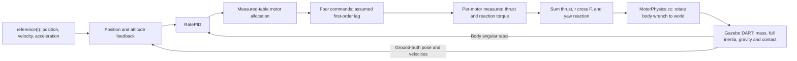

# Force-driven flight simulation: physics model

Install, build and run commands are in [../README.md](../README.md). This page
describes the physical model and its assumptions.

The simulation runs a dynamic Gazebo rigid body (Harmonic or Fortress, DART
engine). It never commands the vehicle pose or velocity.



Headless mode runs the same DART engine, generated SDF, C++ adapter and Python
controller directly, without a rendering server or transport sockets. Simulation
timestamps, not wall-clock time, drive control. `worlds/frame.sdf` is the scene
template: the runner generates a dynamic single-body drone from it and merges the
fixed motor visuals into the base link. RViz remains a geometry viewer.

## Mass and inertia

User-supplied approximate masses:

| Component | Mass |
|---|---:|
| Central frame plus electronics | 244 g |
| Four arms | 4 × 42 g |
| Four motors | 4 × 72 g |
| Total modeled mass | 700 g |

`tools/derive_mass_properties.py` finds the four matching arm solids in the
19-solid STEP assembly (indices 4, 12, 14, 18, zero based). Their volume and
42 g mass give a common density of 1133.883 kg/m³. Applying that density to the
remaining CAD solids gives 62.213 g central-frame mass; the residual 181.787 g
is electronics, modeled as a point at the assembled centre of mass. This applies
the same density to small CAD brackets/standoffs as an approximation.

The motor bodies are absent from CAD, so each motor is a 72 g point at its
provisional mount. Its own-body and spinning-rotor inertia are omitted. No
battery, propeller or payload mass has been added.

The script sums exact solid central inertia tensors and parallel-axis terms:

```text
CoM in original CAD axes [m]:
[0.0000001721, 0.0000262766, -0.0021347590]

Inertia about CoM in those axes [kg m²]:
[[ 0.0070850588, -0.0000000012, -0.0000000028],
 [-0.0000000012,  0.0120359596, -0.0000059554],
 [-0.0000000028, -0.0000059554,  0.0190787109]]
```

The body frame is centred at this CoM and parallel to CAD axes; visuals and
allocation lever arms are shifted accordingly. Full off-diagonal inertia terms
are used. Electronics at CoM adds mass without central inertia. Component
calculations are in `cad/mass_properties.json`. Component masses and the arm
classification are constants in the script; rerun it (see
[../README.md](../README.md#5-regenerate-inputs)) to update `control/config/drone.json`.

## Parameters and controller

`control/config/drone.json` holds mass, CoM, inertia diagonal/products, four
motor positions and yaw-reaction signs, four measurement tables (paths relative
to the config file), motor time constants, drag, control/physics periods,
PID/outer-loop gains and reference parameters. Select another vehicle with
`--config path.json`; effective run configs use absolute paths.

`control/physics_control.py` contains position/attitude feedback, calls the
RatePID and Allocator, updates actuator lag every physics step, interpolates the
motor tables and computes all per-motor moments. The C++ plugin embeds Python in
process, so there is no subprocess or ROS message per control step and no ROS
reference topic yet. Feedback is exact simulated state, not a sensor model.

Normalized command 0 is the lowest measured spinning point; the simulation does
not invent a zero-thrust row, and freefall mode disconnects propulsion instead.
Motor lag (40 ms), drag and gains are assumed values, not identified hardware
parameters. Current is a steady-state lookup estimate; voltage effects, battery
limits and motor electrical dynamics are absent. Allocation residuals are
logged; rate PID anti-windup covers its own torque limits, not downstream
allocation saturation, so large infeasible references may wind up the
controller. Restart the runner after a simulation-time reset.

## Contact and buoyancy

Ground and bowl contacts use static primitive approximations of the scene
meshes, leaving the pond opening clear in both Gazebo and direct DART. The drone
has a provisional 406 × 320 × 60 mm collision box.

The pond is a finite cylinder with 1000 kg/m³ water, surface at z = -0.005 m and
bottom at z = -2 m, read from `control/config/water.json`. Buoyancy follows
displaced volume for separately sampled central frame, four arms and four motor
housings. Forces act at each immersed sample, so partial entry also creates a
restoring moment. Component dimensions and water shape are approximations; waves
and water drag are not modeled. Buoyancy is on by default in GUI, headless and
direct controller runs. The `--scripted` legacy animation does not run physics.

## Verification

Test commands are in [../README.md](../README.md#6-tests); `python3
tools/plot_physics.py` plots the validation outputs. The native bridge test
drives a Gazebo entity/component state through Python control to the
ExternalWorldWrenchCmd component. Integration checks use DART to verify
ballistic freefall, both signs of roll/pitch/yaw under unequal motor commands,
and 38 s of closed-loop takeoff/figure-eight tracking. Reports, engine logs,
effective configs, SDFs and telemetry go to `analysis/physics_validation/`. The
initial validation achieved 5.74 cm path RMS position error and 1.49988 m final
altitude. These validate the approximate model and controller, not the real
aircraft.
